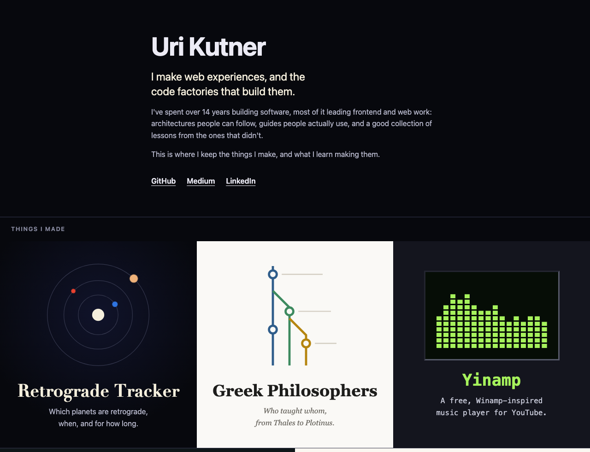

# Uri Kutner — personal site

The home of the things I make, and what I learn making them. This is the code behind [nefzen.dev](https://nefzen.dev/).

[](https://nefzen.dev/)

Built with [Astro](https://astro.build/) on [Bun](https://bun.com/) as a static site.

## Develop

```sh
bun install
bun run dev       # local dev server
bun run build     # static build into dist/
bun run check     # type-check
```

## Where things are

- `src/pages/index.astro`: the home page, including the links and the list of articles.
- `src/components/YinampSpectrum.astro`: the LED visualizer on the Yinamp card, ported from Yinamp itself.
- `src/layouts/Base.astro`: shared `<head>` (title, description, canonical and social tags).
- `public/og.png`: the social preview image. Edit `scripts/og.html`, then run `bun scripts/og.ts` to render it (needs Chrome).
- `src/pages/sitemap.xml.ts`, `src/pages/robots.txt.ts`: sitemap and robots, built from `SITE_URL`.
- `src/components/Analytics.astro`: GoatCounter, loaded in production builds only.
- `.env`: public build settings (`SITE_URL`, `SITE_NAME`, `GOATCOUNTER_CODE`). Committed on purpose; local overrides go in `.env.local`.

## Deploy

Every push to `main` builds and deploys to GitHub Pages through `.github/workflows/deploy.yml`.

## Projects linked from the site

- [Retrograde Tracker](https://retrograde.nefzen.dev/)
- [Greek Philosophers](https://philo.nefzen.dev/)
- [Yinamp](https://yinamp.nefzen.dev/)
